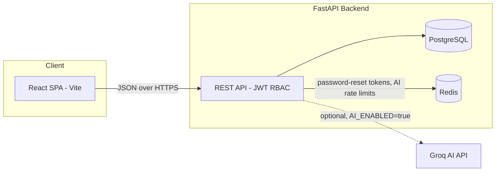

# Neighbourly

> A full-stack Smart Apartment Community Management System


Neighbourly is a role-based apartment/society management platform that simplifies communication, maintenance, billing, visitor management, facility booking, document handling, and community engagement for apartment societies. It ships as a **monorepo**: a React SPA (`frontend/`) talking over a JSON REST API to a FastAPI backend (`backend/`), backed by PostgreSQL and Redis.


## Table of Contents

- [What the Project Does](#what-the-project-does)
- [Project Team](#project-team)
- [Key Features](#key-features)
- [Tech Stack](#tech-stack)
- [Architecture](#architecture)
- [Project Structure](#project-structure)
- [Getting Started](#getting-started)
- [Environment Variables](#environment-variables)
- [Demo Credentials](#demo-credentials)
- [API Documentation](#api-documentation)
- [Testing](#testing)
- [Current Status](#current-status)
- [Future Enhancements](#future-enhancements)
- [Contributing](#contributing)
- [Troubleshooting](#troubleshooting)
- [License](#license)

## What the Project Does

Neighbourly provides separate experiences for five roles, enforced end-to-end with JWT-based role-based access control (RBAC):

- **Admin** — full oversight: residents, apartments, staff, billing, visitors, complaints, facilities, notices, documents, polls, and reports.
- **Committee** — day-to-day building management: verifies new residents/staff, manages residents, billing, facilities, notices, and complaints (a co-equal manager alongside Admin for most operational modules).
- **Resident** — views bills and pays them, raises complaints, pre-registers visitors, books facilities, votes in polls, and stays updated via notices and events.
- **Security** — verifies pre-registered visitors by OTP, logs entry/exit.
- **Maintenance** — accepts/declines assigned complaints and drives them through a schedule → start → complete workflow.

An optional **AI Community Intelligence** module (Groq-powered) adds complaint auto-classification, staff assignment suggestions, smart search, AI complaint-report summaries, and a grounded chat assistant scoped to each role's own data.

## Project Team

| Name           | Roll Number | Role                              |
| -------------- | ----------- | ---------------------------------- |
| Yash Karsh     | 22f3002322  | Project Architect                 |
| Juhi Parekh    | 23f2005473  | Scrum Master                      |
| Safwan Humayun | 24f1001022  | Frontend Developer                |
| Saniya Naaz    | 23f2002592  | Backend Developer                 |
| Saumya Sarkar  | 21f3001551  | Backend Developer / Software Tester |

## Key Features

### Role-Based Access & Dashboards
- **Admin/Committee Portal** — analytics dashboard, full control over residents, apartments, staff, billing, facility bookings, notices, documents, complaints, polls, and visitors.
- **Resident Portal** — quick-stats dashboard, bills & payments, complaints, visitor pre-registration, facility booking, notices, polls, and profile management.
- **Staff Portal** — role-specific views:
  - **Security** — visitor OTP verification, own check-in/out history.
  - **Maintenance** — assigned complaint task queue with accept → schedule → start → complete workflow and resident feedback/ratings.

### Resident Verification & Occupancy
- Residents self-register and pick a flat; a Committee member reviews and verifies the account, which also performs the flat move-in.
- Full move-in / move-out and occupancy-history tracking per flat.

### Facility Bookings
- Residents reserve community facilities by date/time slot, validated against opening hours, slot duration, and conflicting bookings (with row-level locking to prevent double-booking races).
- Admin/Committee approve, edit, or cancel bookings; residents can cancel their own.

### Complaints & Maintenance Workflow
- Residents file complaints with categories, priority, and photo attachments.
- Admin/Committee assign complaints to maintenance staff, who accept/decline and move the job through schedule → start → complete, automatically updating the parent complaint's status.
- Residents leave a rating + feedback once a complaint is resolved.

### Billing & Payments
- Admin generates itemized maintenance bills per flat; residents view and pay them (mocked payment gateway) and download auto-generated receipts.
- Admin dashboard shows billing summaries (billed / collected / outstanding).

### Visitor Management
- Residents pre-register visitors and get a one-time OTP; security verifies the OTP at the gate to log entry, then logs exit later.

### Communication & Notifications
- Admin/Committee publish announcements; every resident gets a personal notification inbox fed by real events across the app (bills, payments, complaints, bookings, visitors, polls).

### Community Polls
- Admin/Committee create polls with multiple options; residents vote once (or multiple times, if allowed) and see live results.

### AI Community Intelligence (optional, Groq-powered)
- Complaint auto-classification (category + priority) at the point of filing.
- AI-ranked maintenance-staff recommendations when assigning a complaint.
- Smart, role-scoped search across complaints and announcements.
- AI-generated complaint summary reports for admins, built on real SQL aggregates.
- A grounded, role-aware chat assistant embedded in the app.

### UI Highlights
- Dark mode, responsive layout, dashboard analytics and charts.
- Search & filters, pagination, loading skeletons, and empty states.
- Toast notifications, accessible components, and smooth animations.

## Tech Stack

### Frontend (`frontend/`)
| Category | Technology |
| --- | --- |
| Framework | React 19 + Vite |
| Styling | Tailwind CSS 4 |
| Routing | React Router DOM 7 |
| State management | Zustand 5 (with `persist` middleware) |
| Forms & validation | React Hook Form + Zod |
| Charts | Recharts |
| Animation | Framer Motion |
| Icons | Lucide React |
| Notifications | Sonner, react-hot-toast |
| HTTP | `fetch`-based client with automatic access/refresh-token handling |

### Backend (`backend/`)
| Category | Technology |
| --- | --- |
| Framework | FastAPI |
| ORM | SQLAlchemy |
| Database | PostgreSQL (`psycopg2-binary`) |
| Cache / short-lived tokens | Redis |
| Auth | JWT access tokens (PyJWT) + opaque, hashed, rotating refresh tokens |
| Password hashing | bcrypt |
| File uploads | `python-multipart`, magic-byte–validated image uploads |
| AI provider (optional) | Groq (OpenAI-compatible chat completions) via `httpx` |
| Testing | pytest, pytest-asyncio, httpx `AsyncClient` |

## Architecture



The frontend is a fully decoupled SPA — every screen fetches data from the FastAPI backend (no mock data). Zustand stores cache API responses client-side and persist auth tokens; every write goes through the backend's role-based authorization checks. See [`backend/README.md`](backend/README.md) for the full API reference.

## Project Structure

```text
MAY2026-Team-015/
├── README.md                 # you are here
├── backend/
│   ├── app/
│   │   ├── core/              # settings, DB session, auth dependencies
│   │   ├── models/            # SQLAlchemy models (30 tables)
│   │   ├── schemas/           # Pydantic request/response DTOs
│   │   ├── routers/           # FastAPI routers, one set per module
│   │   ├── services/          # business logic
│   │   ├── utils/             # security, password/OTP hashing, error/response envelopes, Groq client
│   │   └── main.py            # app factory, middleware, exception handlers
│   ├── scripts/
│   │   ├── init_db.py         # creates all tables
│   │   └── seed.py            # seeds roles, bootstrap admin, demo dataset
│   ├── tests/                 # pytest suite (SQLite-backed)
│   ├── requirements.txt
│   ├── .env.example
│   └── README.md              # backend-specific documentation
└── frontend/
    ├── src/
    │   ├── api/                # one fetch-wrapper module per backend module
    │   ├── components/         # UI components, grouped by feature/role
    │   ├── pages/               # admin/, resident/, staff/ route pages
    │   ├── store/                # Zustand stores (one per domain)
    │   ├── utils/
    │   ├── App.jsx
    │   └── main.jsx
    ├── package.json
    ├── vite.config.js
    └── README.md               # frontend-specific documentation
```

## Getting Started

### Prerequisites

- Node.js 18+
- Python 3.10+
- PostgreSQL (running instance + an empty database)
- Redis (running instance)
- npm, Git

### 1. Clone the repository

```bash
git clone https://github.com/22f3002322/MAY2026-Team-015.git
cd MAY2026-Team-015
```

### 2. Set up and run the backend

```bash
cd backend
python -m venv .venv
source .venv/bin/activate      # Windows: .venv\Scripts\activate

pip install -r requirements.txt

cp .env.example .env           # then fill in DATABASE_URL, SECRET_KEY, REDIS_URL, etc.

python -m scripts.init_db      # creates all tables
python -m scripts.seed         # seeds roles + a demo dataset

uvicorn app.main:app --reload  # http://localhost:8000
```

Interactive API docs are then available at **http://localhost:8000/docs**.

### 3. Set up and run the frontend

```bash
cd frontend
npm install
npm run dev                    # http://localhost:5173
```

By default the frontend talks to `http://localhost:8000`. To point it at a different backend, create `frontend/.env` with:

```env
VITE_API_BASE_URL=http://localhost:8000
```

### Other frontend commands

| Command | Description |
| --- | --- |
| `npm run dev` | Start the Vite dev server |
| `npm run build` | Production build |
| `npm run preview` | Preview the production build locally |
| `npm run lint` | Run ESLint |

Full setup detail for each half of the stack lives in [`backend/README.md`](backend/README.md) and [`frontend/README.md`](frontend/README.md).

## Environment Variables

The backend is configured entirely through `backend/.env` (see `backend/.env.example` for the full list — database, Redis, JWT secret/expiry, password-reset TTL, OTP hashing secret, bootstrap admin credentials, media storage, CORS origins, and optional Groq AI settings). **Never commit a populated `.env` file** — only `.env.example` should be tracked.

The frontend only needs `VITE_API_BASE_URL` if the backend isn't running on `http://localhost:8000`.

## Demo Credentials

After running `python -m scripts.seed`, the following accounts are available (all seeded non-admin accounts share the password `Demo@1234`):

| Role                    | Email                          | Password                          |
| ------------------------ | ------------------------------ | ---------------------------------- |
| Admin                    | value of `ADMIN_EMAIL` in `.env` | value of `ADMIN_PASSWORD` in `.env` |
| Committee                | `ananya.iyer@neighbourly.com`  | `Demo@1234`                        |
| Committee                | `rajesh.menon@neighbourly.com` | `Demo@1234`                        |
| Resident (verified)      | `priya.sharma@neighbourly.com` | `Demo@1234`                        |
| Resident (pending review)| `pending.gupta@neighbourly.com`| `Demo@1234`                        |
| Security                 | `ramesh.yadav@neighbourly.com` | `Demo@1234`                        |
| Maintenance              | `deepak.verma@neighbourly.com` | `Demo@1234`                        |

## API Documentation

- Interactive Swagger UI: `http://localhost:8000/docs` (auto-generated by FastAPI once the backend is running).
- Full, module-by-module endpoint reference, request/response envelope, and auth/role matrix: [`backend/README.md`](backend/README.md).

## Testing

```bash
# Backend (pytest, SQLite-backed — no Postgres/Redis needed for tests)
cd backend
pytest -q

# Frontend (lint only — no unit-test suite yet)
cd frontend
npm run lint
```

## Current Status

- ✅ Full-stack app: React SPA + FastAPI backend, both wired together (no mock data).
- ✅ JWT auth with 5 roles, refresh-token rotation, and committee-driven account verification.
- ✅ All 9 core modules implemented end-to-end (apartments, complaints, maintenance, visitors, facilities, billing, communication, community polls) plus an optional AI module.
- ✅ Responsive design and dark mode.
- ✅ Backend pytest suite covering facilities, visitors, and AI endpoints (SQLite-backed, no external services required).
- ⚠️ No automated schema migrations yet — tables are created directly from the SQLAlchemy models (`scripts/init_db.py`); see the note in that file about moving to Alembic later.
- ⚠️ Payment gateway, OTP delivery, and email notifications are mocked (returned directly in API responses / logged) rather than wired to a real provider.

## Future Enhancements

- Real payment gateway integration (currently a mocked "report the outcome" flow).
- Real email/SMS delivery for OTPs, password resets, and notifications (currently logged/returned in the API response).
- Real-time (push/WebSocket) notifications instead of the current polling inbox.
- Alembic-based database migrations.
- Expanded analytics and reporting.
- Native mobile application.

## Contributing

```bash
# fork the repo on GitHub, then:
git clone https://github.com/22f3002322/MAY2026-Team-015.git
cd MAY2026-Team-015
git checkout -b feature/your-feature
# make your changes
git add .
git commit -m "Add your feature"
git push -u origin feature/your-feature
```

Then open a Pull Request on GitHub against this repository. Please add/update backend tests under `backend/tests/` for any API change.

## Troubleshooting

**Backend won't start / `pydantic_settings` validation errors**
Make sure `backend/.env` exists and every required variable in `backend/.env.example` is set (especially `DATABASE_URL`, `REDIS_URL`, `SECRET_KEY`, `OTP_HASH_SECRET`, `ADMIN_EMAIL`, `ADMIN_PASSWORD`).

**`could not connect to server` / database errors**
Confirm PostgreSQL is running and `DATABASE_URL` points at a database that exists, then re-run `python -m scripts.init_db`.

**Login/signup works but password reset or AI chat fails**
Confirm Redis is running and `REDIS_URL` is reachable.

**Frontend shows network errors on every page**
Confirm the backend is running on the URL the frontend expects (`VITE_API_BASE_URL`, default `http://localhost:8000`) and that `CORS_ORIGINS` in `backend/.env` includes the frontend's origin (default `http://localhost:5173`).

**Dev server won't start**
```bash
cd frontend
rm -rf node_modules package-lock.json   # on Windows: Remove-Item -Recurse -Force node_modules, package-lock.json
npm install
npm run dev
```

**Port already in use**
Vite defaults to port `5173`; FastAPI/uvicorn defaults to `8000`. Stop the other process using that port, or start on a different one:
```bash
npm run dev -- --port 5174
uvicorn app.main:app --reload --port 8001
```

## License

This project is developed for educational and portfolio purposes.